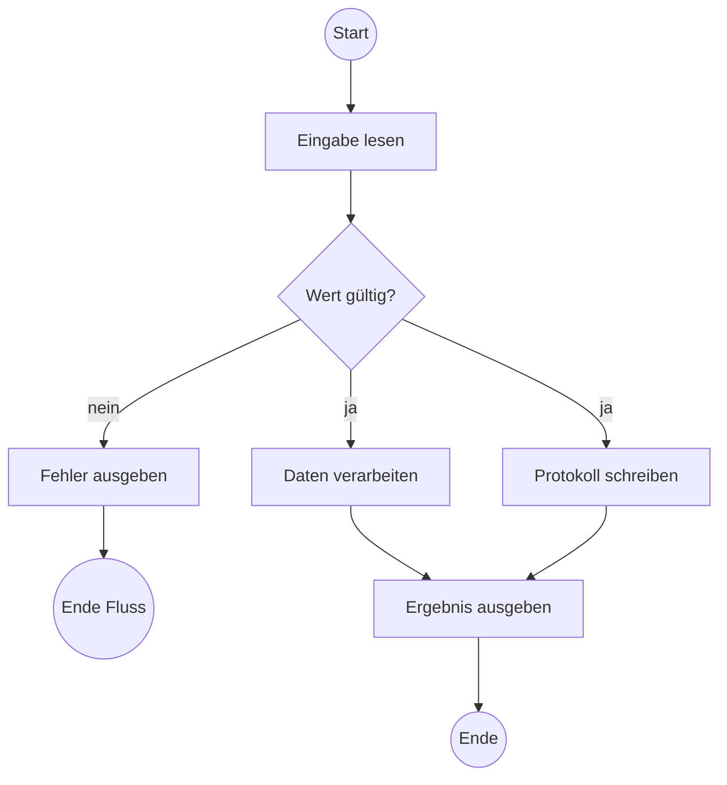
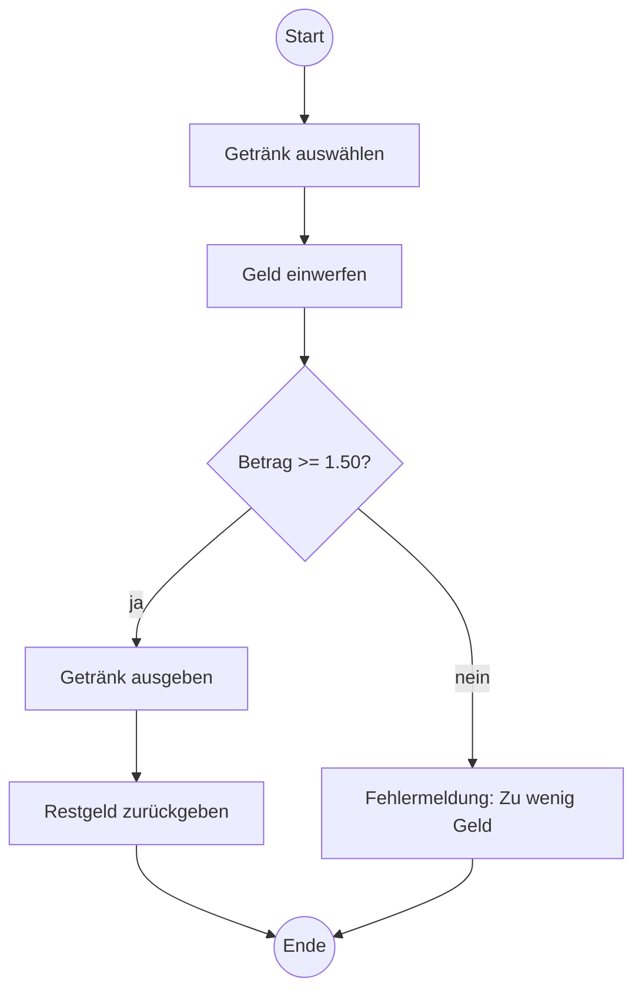
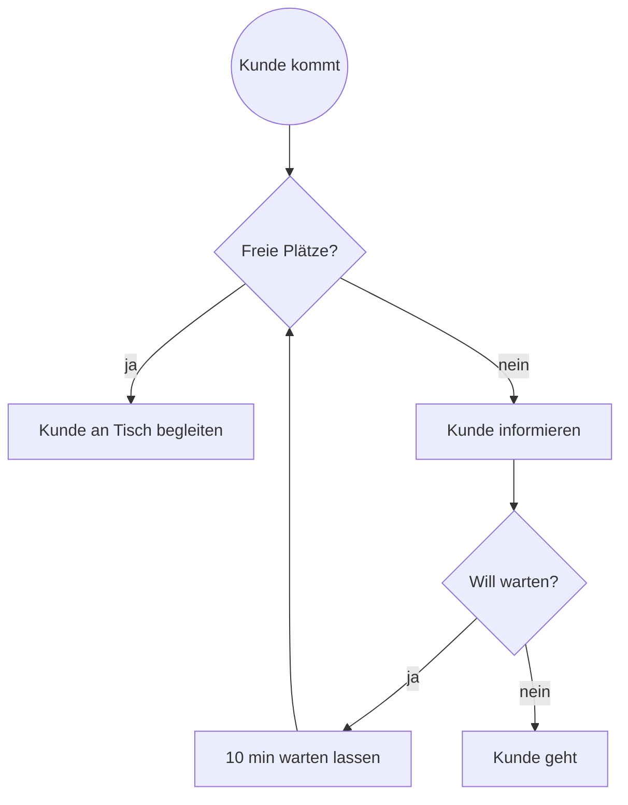
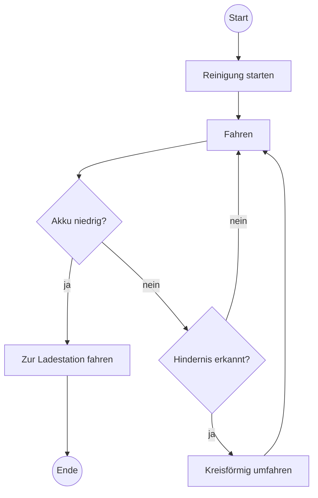

# Einstieg UML – Activity Diagram

**Modul:** Einstieg Programmieren (BE2026 PE)
**Tags:** #UML #Aktivitätsdiagramm #Flussdiagramm #Ablauf

---

## Lernziele

- [ ] Erklären, was UML ist und wozu es dient
- [ ] Die Symbole eines Aktivitätsdiagramms kennen
- [ ] Abläufe mit Entscheidungen, Schleifen und Parallelität modellieren
- [ ] Generische Prozesse beschreiben

---

## Was ist UML?

**Unified Modeling Language** = **keine** Programmiersprache, sondern eine **grafische Sprache** zum Planen und Beschreiben von Software(-systemen).

Diagrammtypen: Klassendiagramm, **Aktivitätsdiagramm**, Sequenzdiagramm. Im Modul: **Aktivitätsdiagramme** (= Ablaufdiagramme = Flussdiagramme).

> Bekanntes Beispiel: Sheldons Freundschafts-Flussdiagramm aus *The Big Bang Theory* ist formal ein Aktivitätsdiagramm.

### Zweck

- **Visualisierung** komplexer Systeme (wie Baupläne)
- **Kommunikation** im Team (gleiche Symbole, gleiche Sprache)
- **Dokumentation und Training**
- **Simulation und Validierung** der Ablauflogik vor der Implementierung

### Anwendungsgebiete

Software-Engineering, Geschäftsprozesse, eingebettete Systeme, Web- und Mobile-Apps, Lehre und Forschung.

---

## Standardisierte Symbole

| Symbol | Name | Verwendung |
|--------|------|------------|
| ● (gefüllter Kreis) | **Start- / Anfangsknoten** | Startpunkt der Aktivität |
| Rechteck mit runden Ecken | **Aktion** | ausführbarer Teilschritt |
| Pfeil | **Kontrollfluss / Kante** | Verbindung von Aktion zu Aktion |
| ◉ (Kreis mit Punkt) | **Aktivitäts-Endknoten** | Ende **aller** Kontrollflüsse |
| ⊗ (Kreis mit X) | **Fluss-Endknoten** | Ende **eines einzelnen** Flusses |
| ◇ (Raute) | **Entscheidungsknoten** | bedingte Verzweigung: 1 Eingang, mehrere Ausgänge |
| Dicker Balken | **Gabelung / Zusammenführung** | parallele Abläufe aufteilen und wieder vereinen |
| Notiz-Rechteck | **Anmerkung / Kommentar** | Hinweise zu Elementen |

![[uml-symbole.png]]

![[uml-symbole-2.png]]

### Beispielablauf

![[uml-beispiel.png]]

1. Eingabe lesen
2. **Wert gültig?**
   - nein → Fehler ausgeben → Flussende
   - ja → **Gabelung**: gleichzeitig *Daten verarbeiten* und *Protokoll schreiben*
3. **Zusammenführung** → Ergebnis ausgeben → Endknoten

### Beispiel Getränkeautomat (1.50 CHF)

---

## Entscheidungen treffen

- Im **Entscheidungsknoten** steht eine **Frage**, die Wege führen je nach Antwort weiter
- In der Programmierung entspricht das einer **if-Verzweigung**
- Beispiel Selecta-Automat: Nummer ungültig? Geld reicht nicht? Abbruch?

---

## Schleifen (Loops)

Viele technische Abläufe wiederholen sich. In UML geht ein Pfeil **zurück** vor einen Entscheidungsknoten.

**Beispiel Staubsaugerroboter:** Reinigung starten → fahren → Akku niedrig? (ja → zur Ladestation, Ende) → Hindernis? (ja → kreisförmig umfahren) → weiterfahren (Schleife).

![[uml-staubsauger.png]]

---

## Generische Prozesse

Ein **generischer Prozess** funktioniert in vielen Situationen, ohne dass der Ablauf umgebaut werden muss. Der Grundablauf wird einmal definiert, nur die **Parameter** werden ausgetauscht (Parallele zu Funktionen mit Parametern).

**Beispiel Traktor-Autopilot:**

1. Parameter laden (Feldmasse, Gerätebreite)
2. Startposition anfahren
3. Feld abfahren: Spur geradeaus → Feldrand erreicht? Nein: weiterfahren / Ja: seitlich um Gerätebreite versetzen → wiederholen bis keine Spur offen
4. Ende, Anzeige "Fertig"

---

## Übungen im Kurs

| Übung | Ziel |
|-------|------|
| **Papierflieger** | Diagramm so genau, dass Teampartner:in nur damit den Flieger falten kann (mit Start, Aktionen, Endknoten; Papier oder draw.io) |
| **Restaurant-Service** | möglichst viele Szenarien abdecken (trinken, essen, unentschlossen, Alkohol unter 18, Toilette, bezahlen); Ablauf mit Teamkollege durchspielen, bis ca. 90 % abgedeckt |
| **Postbote mit E-Scooter** | mind. 1 Start/Ende, 3 Entscheidungen, 2 Schleifen; Brief, Paket, niemand da, Nachbar, Akku leer, Rückkehr ins Depot |

**Tipps:** klare Beschriftungen ("Klingeln", "Empfänger da?"), Probleme als Entscheidungen abbilden, kein fehlender Endknoten.

---

## Verknüpfungen

→ [[05 - Entscheidungen mit if, elif und else]]
→ [[07 - While-Schleife]]
→ [[17 - Probleme lösen]]
