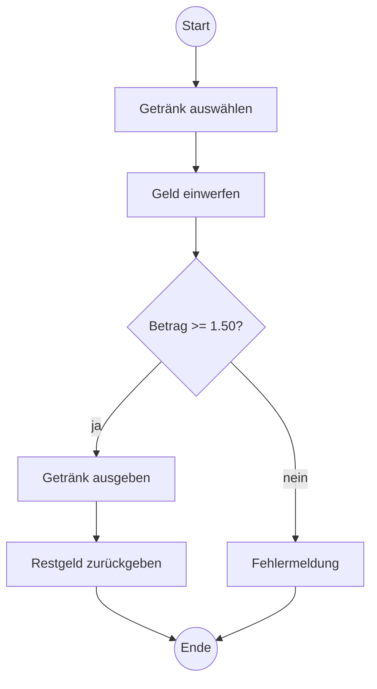

# Einstieg UML – Activity Diagram

**Modul:** Einstieg Programmieren (BE2026 PE)
**Tags:** #UML #Aktivitätsdiagramm #Flussdiagramm

---

## Was ist UML?

**Unified Modeling Language.** Keine Programmiersprache, sondern eine **grafische Sprache**, um Software zu planen und zu beschreiben. Im Modul: **Aktivitätsdiagramme** (= Ablauf- oder Flussdiagramme).

**Wofür:** Systeme visualisieren, im Team dieselben Symbole nutzen, dokumentieren, Abläufe vor dem Programmieren testen.

---

## Symbole

![[uml-symbole.png]]

![[uml-symbole-2.png]]

| Symbol | Name | Bedeutung |
|--------|------|-----------|
| ● | Start | Startpunkt |
| Rechteck mit runden Ecken | Aktion | ein Schritt |
| Pfeil | Kontrollfluss | verbindet die Schritte |
| ◉ | Aktivitäts-Endknoten | Ende **aller** Flüsse |
| ⊗ | Fluss-Endknoten | Ende **eines** Flusses |
| ◇ | Entscheidung | 1 Eingang, mehrere Ausgänge |
| dicker Balken | Gabel / Zusammenführung | parallele Abläufe |
| Notiz | Anmerkung | Kommentar |

![[uml-beispiel.png]]

Ablauf: Eingabe lesen → Wert gültig? Nein → Fehler ausgeben, Fluss endet. Ja → gleichzeitig Daten verarbeiten und Protokoll schreiben → zusammenführen → Ergebnis ausgeben → Ende.

---

## Entscheidungen

Im Entscheidungsknoten steht eine **Frage**. Je nach Antwort geht es auf einem anderen Weg weiter. Im Code ist das ein `if`.

---

## Schleifen

Ein Pfeil geht **zurück** vor eine Entscheidung. Beispiel Saugroboter: fahren → Akku niedrig? (ja: zur Ladestation, Ende) → Hindernis? (ja: umfahren) → weiterfahren.

![[uml-staubsauger.png]]

---

## Generische Prozesse

Der Grundablauf wird einmal definiert, nur die **Parameter** wechseln. Wie eine Funktion mit Parametern.

**Traktor-Autopilot:** Parameter laden (Feld, Gerätebreite) → Startposition anfahren → Spur fahren → Feldrand erreicht? Nein: weiter, Ja: seitlich versetzen → wiederholen → Ende.

---

## Übungen im Kurs

- **Papierflieger:** Diagramm so genau, dass jemand anderes nur damit den Flieger faltet
- **Restaurant:** viele Szenarien abdecken, mit dem Teampartner durchspielen (ca. 90 %)
- **Postbote mit E-Scooter:** mind. 1 Start und Ende, 3 Entscheidungen, 2 Schleifen

---

→ [[05 - Entscheidungen mit if, elif und else]] · [[07 - While-Schleife]] · [[17 - Probleme lösen]]
